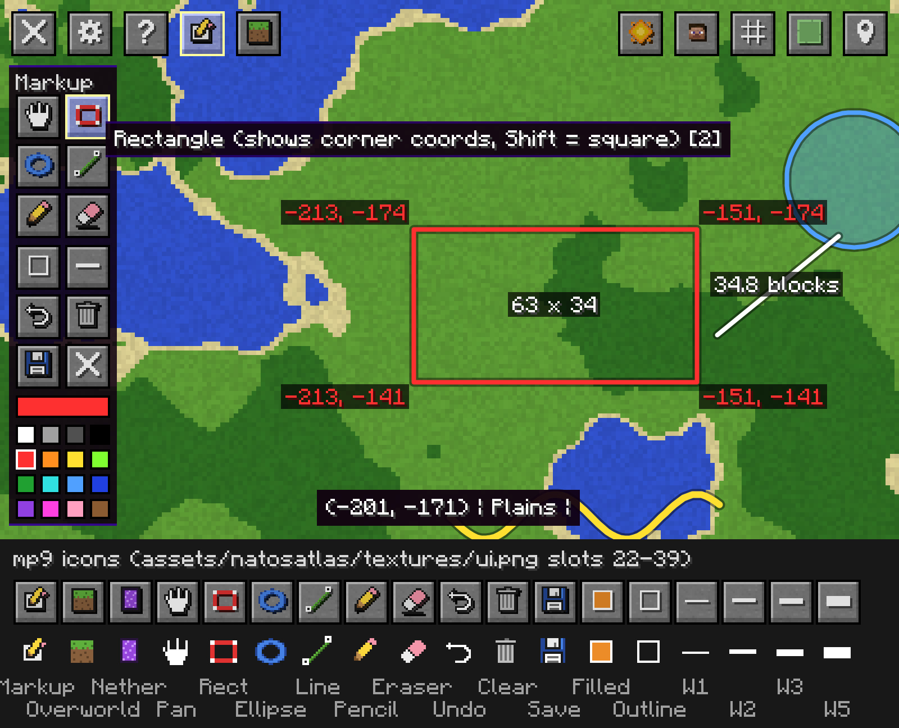

> **Unofficial multiplayer fork (1.5.4-mp) of [Natos Atlas](https://github.com/natowb/bm-natosatlas) by natowb, MIT licensed (see `LICENSE`, unchanged).**
> This fork is based on upstream tag `1.5.4` and adds multiplayer fixes, a True colour block mode, Classic grass in True colour mode, server region-file import, a manual slime seed and a corrected slime-chunk formula. See the change notes at the bottom.
> Only the **StationAPI** build was patched and tested (Babric, StationAPI 2.0.0-alpha.6.4 at runtime). The ModLoader/BTA modules share the core code but were not tested.
> Fork builds are on this repo's Releases page; the upstream releases link below is the original mod.

<p align="center">
  
</p>

A world map mod for **Minecraft Beta 1.7.3**, currently available for **StAPI**,  **ModLoader**, and **BTA**.

## 🚧 Early Development Notice
This project is in a very early stage. Designs are experimental, features will change frequently, and instability is expected while work progresses toward version 1.0.

## Requirements

**ModLoader Requirements:**
* [Mod Loader b1.7.3](<https://mcarchive.net/mods/modloader>)

**StAPI Requirements:**
* [Babric Prism/MultiMC Instance](<https://github.com/babric/prism-instance>)
* [StationAPI >=2.0.0-alpha.3](<https://modrinth.com/mod/stationapi>)

**BTA Requirements**
* [BTA Fabric Loader](<https://github.com/Turnip-Labs/fabric-loader/releases>)
* [Halplibe >= 5.3.3](<https://github.com/Turnip-Labs/bta-halplibe/releases/tag/v5.3.3>)

## 📦 Installation
If you already have a Minecraft Beta 1.7.3 instance set up with either **ModLoader** or **StAPI**,
simply download the latest build from the [Releases page](https://github.com/natowb/bm-natosatlas/releases) and place the file into your instance’s `mods` folder.

## 🖼️ Preview

### Map Modes
<p align="center">
  
  
  
</p>

### Waypoints
<p align="center">
  
  
  
</p>

### Map Controls
<p align="center">
  
  
  
  
</p>


---
## 1.5.4-mp1 (multiplayer patch)
Unofficial fork of Natos Atlas 1.5.4 by **natowb** (https://github.com/natowb/bm-natosatlas), MIT licensed (see LICENSE, unchanged).
Changes: block reads clamped to valid chunk bounds (fixes the Y=-1 crash on join), empty/unreceived chunks are skipped and retried,
per-chunk and per-tick errors are logged instead of crashing, server folder names sanitized (IPv6/special characters), null-safe player/world/biome access.
## 1.5.4-mp2
Unloaded/placeholder chunks are detected with `World.isPosLoaded` + `instanceof EmptyChunk` (pattern from Rei's Minimap Babric port by FarnGitHub, MIT).
Dirty map regions are saved under the old dimension before a dimension change or disconnect; the save queue's pending map is now thread-safe.
## 1.5.4-mp3
Settings > World map > "Block colours": Classic (default, original material colours) or True colour (average of each block's top texture from the active texture pack's terrain.png, cached per block id+meta, grass/leaves biome-tinted, fluids keep classic water colours).
## 1.5.4-mp4
In True colour mode the grass block keeps its Classic colour and biome tint; all other True colour behaviour is unchanged.
## 1.5.4-mp5: import a server's region files (multiplayer)
1. On the server machine, find the world's region folder: `<server folder>/<level-name>/region/` (Overworld, usually `world/region/`) and `<level-name>/DIM-1/region/` (Nether).
2. Join the server once with this mod; it creates `.minecraft/natosatlas/servers/<server folder>/import/` and `import/DIM-1/` (server folder = `host-port`, e.g. `100.73.7.65-25567`).
3. Copy the `r.X.Z.mcr` files into `import/` (Overworld) or `import/DIM-1/` (Nether). Putting them in an `import/region/` subfolder also works. Your files are only read, never changed or deleted.
4. In-game, stand in that dimension, open the map, press Options, then General, then **Import .mcr** (called **Import region files** before mp8). Progress (chunks done / total) shows on the settings and map screens. It runs in the background in small slices each tick, and you can keep playing. Press the button again to cancel.
Imported chunks overwrite what the map had for them, including the area around you; live scanning then repaints chunks you're near as usual (since mp8). Corrupt chunks or files are skipped and logged. `.mca` (Anvil) files are ignored.
## 1.5.4-mp6
Options > World map > "Slime seed (blank = server seed)": a per-server manual world seed for the slime chunk overlay (number or text seed). Also fixes the slime chunk formula to match b1.7.3's own check exactly (the original was wrong far out on the X axis).

## 1.5.4-mp7: save the whole map as a PNG, delete map data
Options > General has three new buttons in the right-hand column:
- **Save map image (full)**: every explored part of the current world/server and dimension, in the map mode you're viewing (Day, Night or Cave; Auto picks the same one the map shows), 1 pixel per block. Saved to `.minecraft/screenshots/worldmap-yyyy-MM-dd_HH.mm.ss.png`.
- **Save map image (small)**: the same at 1 pixel per 4x4 blocks (box-averaged, not nearest), saved as `worldmap-<timestamp>-small.png`.
- **Delete all map data**: click twice within 4 seconds. Deletes every stored map tile (all dimensions and layers) for the current world/server only, clears the tiles in memory, and the map starts filling in again as you move. Waypoints, the slime seed, the `import/` folder and settings are kept.

On the map screen, **P** saves the full image and **Shift+P** saves the small one (P used to write a blocking `exported_map_layer_N.png` into the server folder).
Images are cropped to the explored area. Unexplored parts are transparent. Each image records its top-left world block in its PNG comment. Saving runs on a background thread and writes the PNG in strips, so memory stays low. Images over 32768 px on a side are refused with a chat message suggesting the small version. Existing files are never overwritten (`_1`, `_2`, ... is added). Progress and results show in chat and on the options/map screens.
Tile saves now go to a temp file and are then moved into place, so the export never reads half-written tiles.

## 1.5.4-mp8: import fills the area you're in, "Open folder" button
- **Fix:** importing no longer leaves a big black square around you. The importer used to skip every chunk your client had loaded, which is the server's whole view-distance square, but live mapping only scans an 8-chunk circle, so the rest of that square stayed blank. Imported chunks now overwrite those too, in memory and on disk, and the map updates right away. Pixels of chunks that aren't in the import are left alone. Live mapping still repaints chunks you're near afterwards.
- **Safer saving:** a map tile with unsaved changes, or with a save queued or in progress, is never dropped from the in-memory cache, so it can't be reloaded from an older PNG and saved over newer data. A change made while its tile is being written now queues another save instead of being lost. Tile textures re-upload on the next frame they're drawn instead of waiting for the save queue.
- **Open folder:** Options > General, next to **Import .mcr**. Opens this server's `import/` folder (or `import/DIM-1/` in the Nether) in your file manager, creating `import/` and `import/DIM-1/` if missing. It uses Explorer on Windows, `open` on macOS and `xdg-open` on Linux, falling back to Java's Desktop and then LWJGL's `Sys.openURL` (like vanilla's texture pack folder button). If none of them work, the path is shown under the buttons. Multiplayer only, like the import.

## 1.5.4-mp9: dimension toggle, markup mode
**Dimension toggle.** A new button (or press **D**; since mp10 it sits at the left end of the top-right row of map buttons) that switches the map between the Overworld and the Nether without moving you. The other dimension is drawn from its saved tiles and waypoints, read-only: live mapping keeps writing only to the dimension you're actually in, and the import still uses your dimension. The view stays on the matching place (x8 or /8), your arrow is replaced by a see-through "ghost" at your converted position, a "Viewing: Nether (you are in the Overworld)" label shows at the top, and the bottom bar shows the matching coordinates in your dimension. Space centres on the ghost. You can't add waypoints there. P / Shift+P save the dimension you're viewing. Going through a portal while the map is open switches the view back to where you are.

**Markup mode.** The pencil button after Help in the top-left row (or **B**) opens a toolbar on the left, laid out like Paint.NET's Tools panel and drawn with the map's own buttons:

<p align="center"></p>

- Tools (**1**-**6**): Pan, Rectangle, Ellipse, Line, Pencil, Eraser. Rectangles snap to whole blocks and show the block coordinates of all four corners plus the size (e.g. `63 x 34`), while drawing and afterwards. Lines show their length while drawing. Hold **Shift** for squares, circles and 45 degree lines.
- Fill on/off (**F**), line width 1/2/3/5 px (**[** and **]**), Undo (**Ctrl+Z**), Clear all (undoable), Save (**Ctrl+S**), Close (X).
- Colour: 16 colour palette under the tools; the bar above it is the current colour.
- Shapes are stored in world coordinates, so they stay in place when you pan, zoom or rotate. Right drag still rotates and middle drag pans with any tool.
- **Save** writes the map (the dimension and mode shown) around your markup, plus a margin, with the markup and corner coordinates drawn on it, to `.minecraft/screenshots/worldmap-markup-yyyy-MM-dd_HH.mm.ss.png`: up to 8 px per block, 4096 px max per side, north up. With no markup it saves the area on screen.
- Markup lives in memory only: **Esc** (or the X, or closing the map) closes markup mode and forgets it unless you saved it. The first Esc closes markup; the next one closes the map.

Also fixed: the coordinates at the bottom of the map (and new waypoints from a double click) were one block off towards +X/+Z; they now show the block under the cursor. Waypoints are reloaded when you change dimension, so a death or temp waypoint can no longer write the old dimension's list into the new dimension's file. Middle drag pans the map.

## 1.5.4-mp10
The dimension toggle button moved from the top-left row (next to Markup) to the left end of the top-right row, next to the map mode, entities, grid, slime and waypoint buttons. D still toggles it.

## Building this fork
Built with JDK 21. From the repo root:
```bash
./gradlew :natosatlas-stationapi:build
```
The jar lands in `natosatlas-stationapi/build/libs/`. The fork is compiled against StationAPI 2.0.0-alpha.5.4 (see `gradle.properties`) and runs fine on alpha.6.4.

## Credit
Natos Atlas is by natowb (https://github.com/natowb/bm-natosatlas), MIT. The unloaded-chunk detection in mp2 follows the pattern from Rei's Minimap Babric port by FarnGitHub (MIT).
